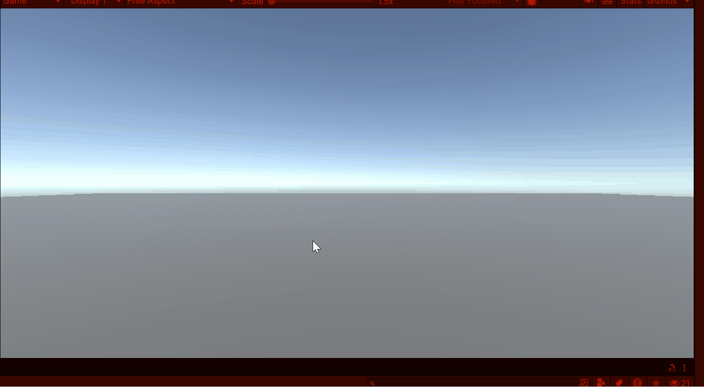
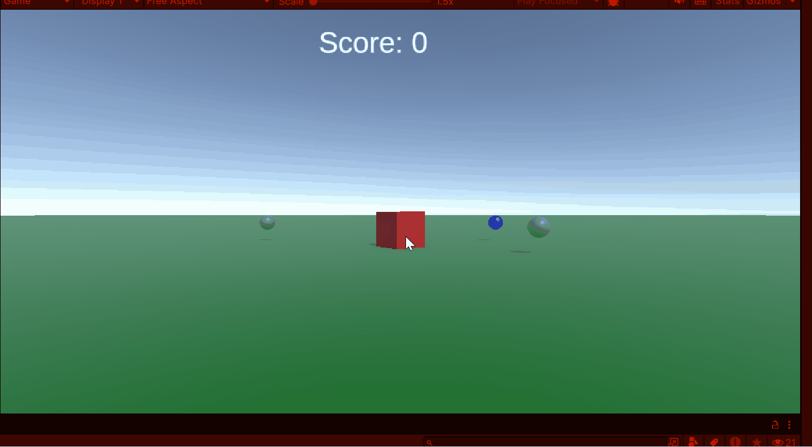
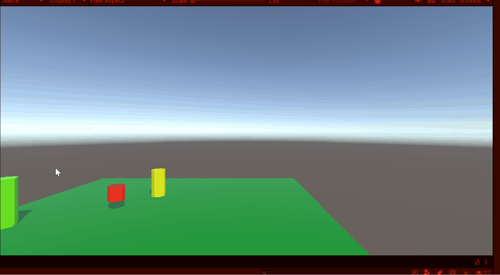

# M5-Prog 

### Opdracht 1.1

### Opdracht 1.2

### Opdracht 1.3

### Opdracht 1.4

### Opdracht 1.5

### Opdracht 1.6

### Opdracht 1.7

### Opdracht 1.8

### Opdracht 1.9

### Opdracht 1.10

### Opdracht 1.11

### Opdracht 1.12

# Les2 

# Les4

# Les5

# Les6
## Depandancies
### class Enemy: 
#### int Health read & write
### class TowerUpgradeStage:
#### float Range read & write
#### float FireRate read & write
#### int Price read & write
#### int UpgradeStage read only
#### int TowerPrice read only
### class CoinManager:
#### int Coins read only
### Scripts
#### Les 1
[Console.cs](Assets\Scripts\Les1\Console.cs)
[TowerSpawner.cs](Assets\Scripts\Les1\TowerSpawner.cs)
[Tower.cs](Assets\Scripts\Les1\Tower.cs)
#### Les 2
[Hit.cs](Assets\Scripts\Les2\Hit.cs)
[Scoreboard.cs](Assets\Scripts\Les2\Scoreboard.cs)
#### Les 5
[Elf.cs](Assets\Scripts\Les5\Elf.cs)
[guisseppe.cs](Assets\Scripts\Les5\guisseppe.cs)
[Orc.cs](Assets\Scripts\Les5\Orc.cs)
[PEnemy.cs](Assets\Scripts\Les5\PEnemy.cs)
