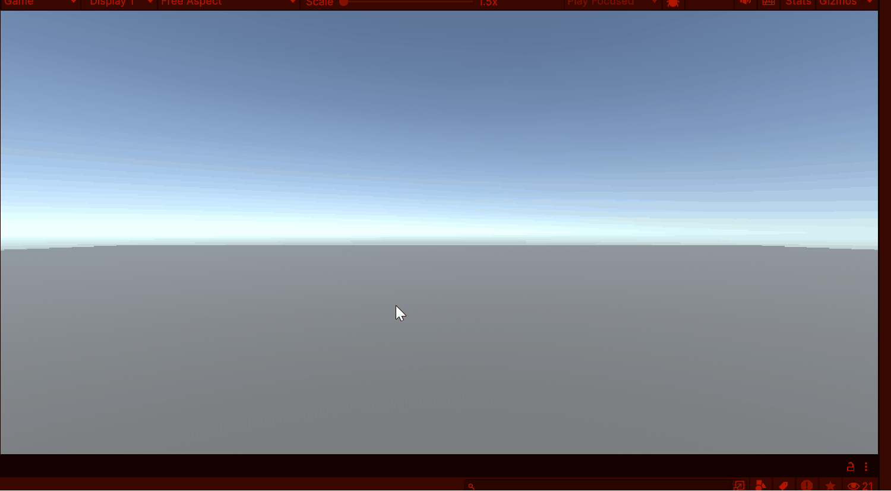

# M5-Prog 

### Opdracht 1.1

### Opdracht 1.2

### Opdracht 1.3

### Opdracht 1.4

### Opdracht 1.5

### Opdracht 1.6

### Opdracht 1.7

### Opdracht 1.8

### Opdracht 1.9

### Opdracht 1.10

### Opdracht 1.11

### Opdracht 1.12

# Les5

### Scripts
#### Les 1
[Console.cs](Assets\Scripts\Les1\Console.cs)
[TowerSpawner.cs](Assets\Scripts\Les1\TowerSpawner.cs)
[Tower.cs](Assets\Scripts\Les1\Tower.cs)
#### Les 5
[Elf.cs](Assets\Scripts\Les5\Elf.cs)
[guisseppe.cs](Assets\Scripts\Les5\guisseppe.cs)
[Orc.cs](Assets\Scripts\Les5\Orc.cs)
[PEnemy.cs](Assets\Scripts\Les5\PEnemy.cs)
